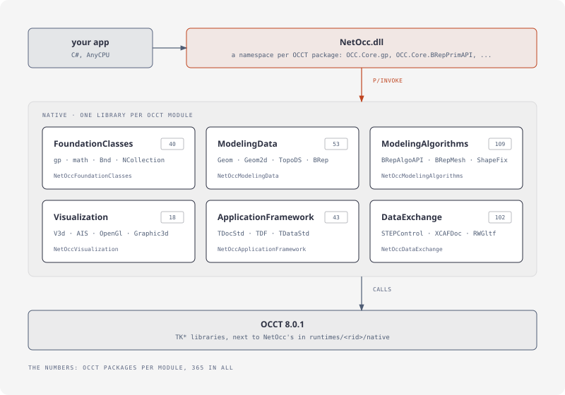
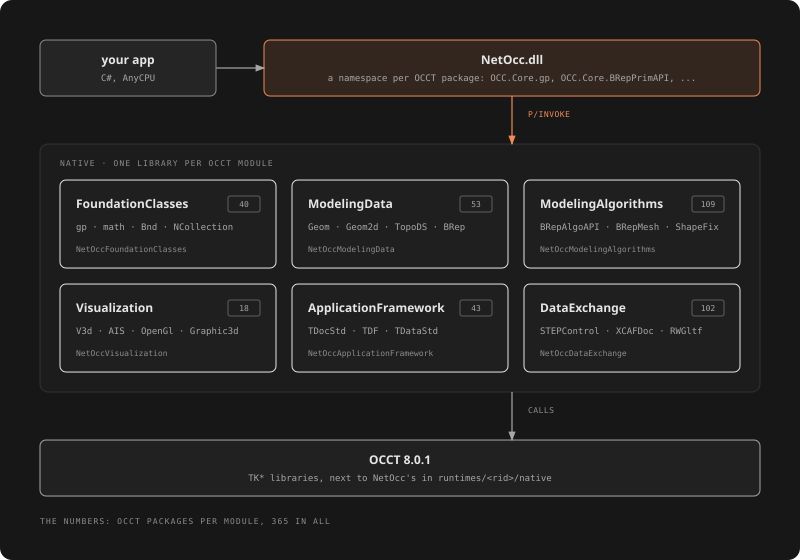

# NetOcc

[Open CASCADE Technology](https://dev.opencascade.org) (OCCT) 8.0.1 for .NET: generated C# bindings with OCCT's names unchanged, one namespace per OCCT package (`OCC.Core.gp`, `OCC.Core.BRepPrimAPI`). One AnyCPU package for .NET Framework 3.5 and 4.5+, .NET 6, 8 and 10, with natives for win-x64, win-x86, linux-x64 and osx-arm64, and OCCT's documentation in IntelliSense.

```bash
dotnet add package NetOcc
```

## The API

OCCT's C++ API, call for call. Three small programs, each complete:

# [Modeling](#tab/modeling)

[!code-csharp[](samples/Programs/Bracket.cs#program)]

# [Measuring](#tab/measuring)

[!code-csharp[](samples/Programs/Measure.cs#program)]

# [Data exchange](#tab/exchange)

[!code-csharp[](samples/Programs/Exchange.cs#program)]

---

How C++ signatures look in C#: [From C++ to C#](articles/mapping.md).

## How it's built




`NetOcc.dll` holds the C# side, for every target framework; it calls one native library per OCCT module, SWIG's wrappers generated from OCCT's headers, which call OCCT. The natives come in one package per platform, `NetOcc.runtime.<rid>`, which `NetOcc` depends on. More in [How NetOcc works](articles/architecture.md).

## Covered

All 365 packages of OCCT's FoundationClasses, ModelingData, ModelingAlgorithms, ApplicationFramework and DataExchange modules, and of Visualization's TKService, TKV3d, TKOpenGl (the driver) and TKMeshVS: geometry, topology, booleans, fillets, offsets, sweeps, shape healing, meshing, HLR, OCAF and XCAF documents, STEP, IGES, STL, glTF, OBJ, PLY and VRML, and 3D views. NetOcc.Vtk puts shapes into VTK scenes, on [NetVtk](https://github.com/paulbuechner/netvtk): [VTK scenes](articles/vtk.md).

## Where to go

| | |
|---|---|
| **Start** | [Introduction](articles/introduction.md): OCCT's layers and packages. [Getting started](articles/getting-started.md): install, a first part. |
| **Guide** | [Geometry](articles/geometry.md), [Topology](articles/topology.md), [Modeling](articles/modeling.md), [Analysis and repair](articles/analysis.md), [Meshing](articles/meshing.md), [Files](articles/data-exchange.md), [Assemblies](articles/xcaf.md), [Documents](articles/ocaf.md), [3D views](articles/visualization.md), [VTK scenes](articles/vtk.md) |
| **Concepts** | [From C++ to C#](articles/mapping.md), [Object lifetimes](articles/lifetimes.md), [Errors](articles/errors.md), [How NetOcc works](articles/architecture.md) |
| **Reference** | [Class index](classes/index.md): every type, linked to OCCT's reference manual. [Platforms](articles/platforms.md), [Building from source](articles/building.md), [Troubleshooting](articles/troubleshooting.md) |
| **Development** | [Design decisions](articles/design.md), [Pitfalls](articles/pitfalls.md), [Licensing](articles/licensing.md), [Skipped members](articles/skipped.md) |

Every example on this site is compiled against the package on each change and run, except the on-screen 3D views, which need a window and a GPU.
